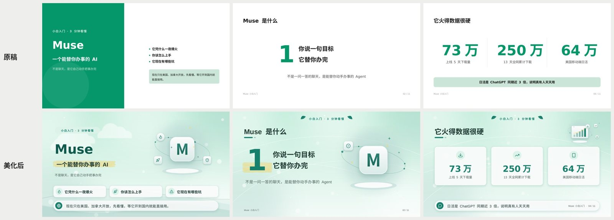
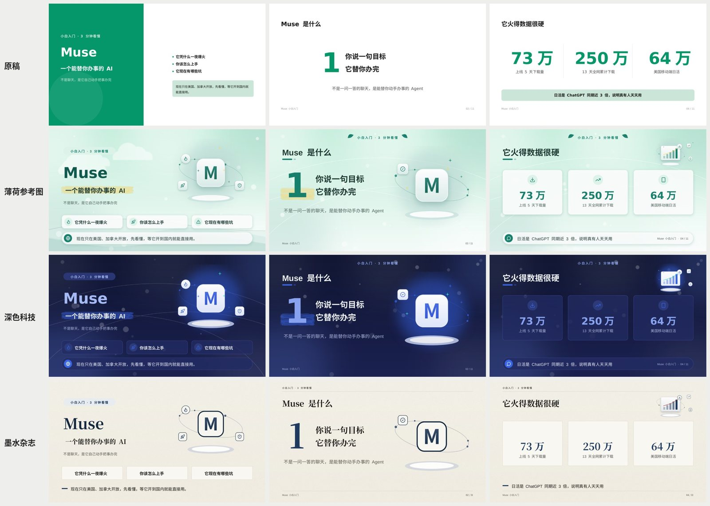
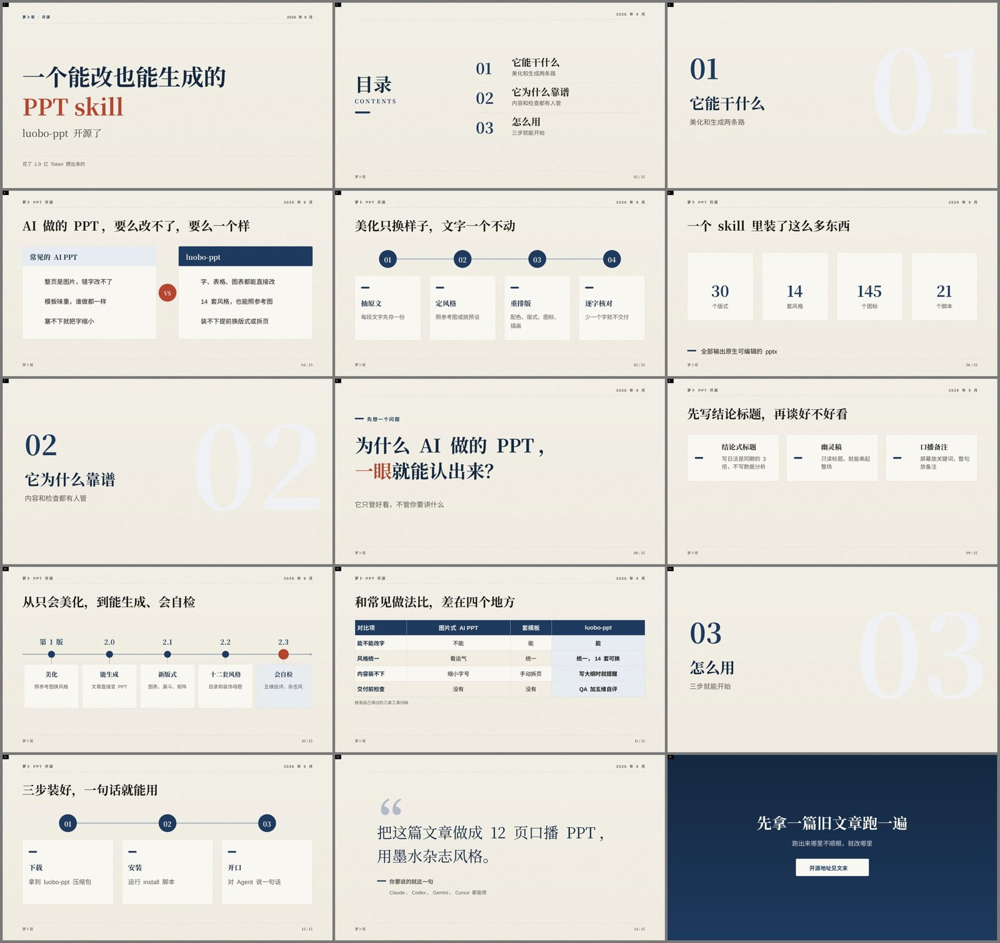
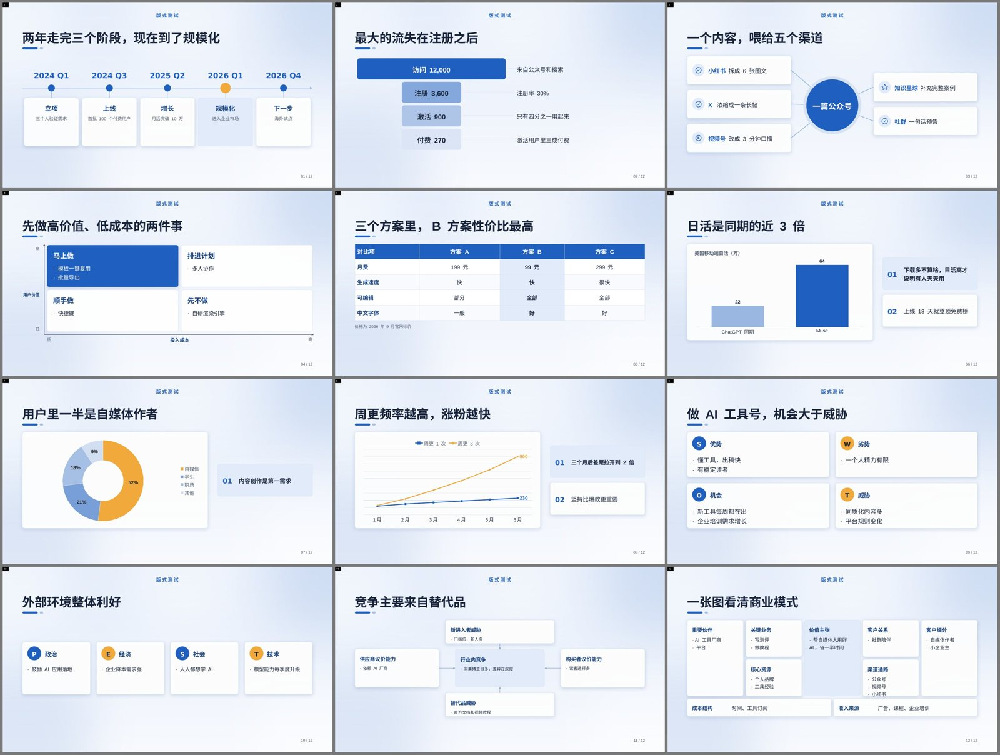
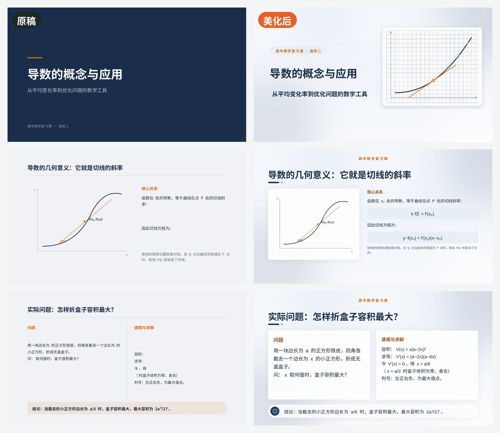
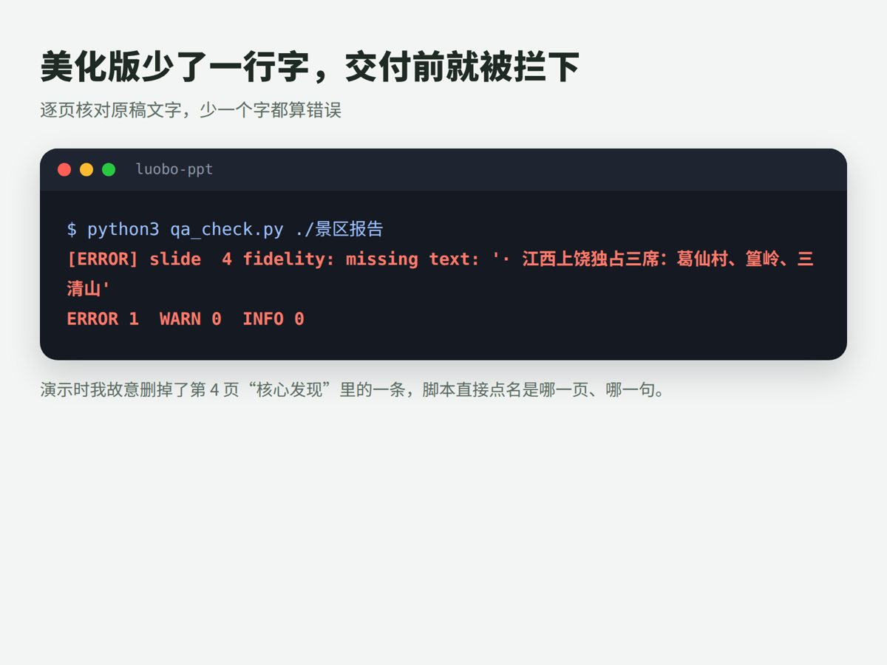
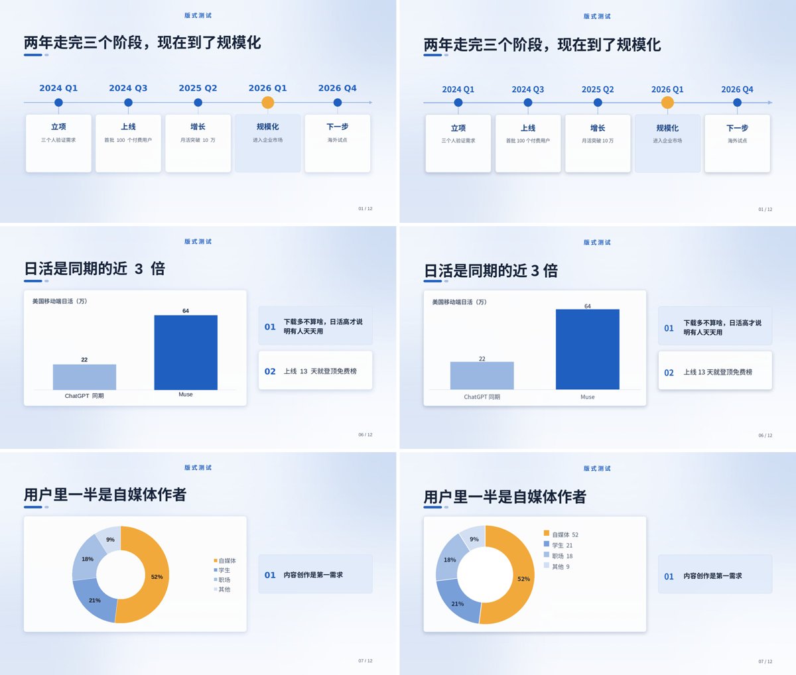
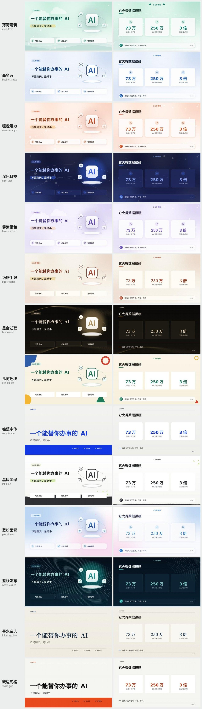

<div align="center">

# Hans PPT

> 把文章、大纲或旧演示稿，变成可继续编辑、可直接演讲的原生 PowerPoint。

[](LICENSE)
[](https://agentskills.io)
[](#交付内容)
[](#版本记录)

**Hans PPT 是一个路由式演示文稿 Agent Skill。**
它先区分新建/重构与 1:1 视觉美化，再把沟通契约、完整方案、原生 PPT 组装和交付检查串成一条可验证流程。

[能力](#核心能力) · [效果](#效果预览) · [安装](#安装) · [使用](#使用方式) · [原理](#工作流程) · [风格](#内置风格)

</div>

---

## 核心能力

| 场景 | 输入 | 输出 |
|---|---|---|
| 从零生成 | 主题、文章、口播稿或大纲 | 有故事线、结论式标题和口播备注的 `.pptx` |
| 美化旧稿 | 原始 `.pptx`，可选参考图 | 内容与页序保持一致、视觉系统重新设计的 `.pptx` |
| 课件重制 | 含公式、图表或示意图的课件 | 公式可见、结构清晰、便于继续修改的课件 |
| 工具教程 | 截图和操作说明 | 带步骤、标注点和流程关系的教程演示稿 |

所有页面可见文字都以可编辑文本框交付；卡片、分隔线、表格和图表尽量使用 PowerPoint 原生对象。参考图只用于提取设计语言，不会被直接贴进页面。旧稿备注只供规划阶段参考，成品采用新演讲契约；未重写的旧备注不会进入成品，明确要求时才逐字保留。

## 效果预览

### 保留原文，重新设计

美化模式会逐页核对原稿文字。配色、版式、图标和插画可以重做，正文默认不改写。



同一份内容可以快速切换不同视觉方向：



### 从文章到可讲的演示稿

生成模式先提炼故事线和结论式标题，再把完整表达放进口播备注。



### 复杂内容仍然原生可编辑

时间线、漏斗、矩阵、原生表格、原生图表，以及 SWOT、PEST、波特五力和商业画布等结构都可以直接生成。



公式对象会转换为跨软件更稳定的可见文本公式，避免在 LibreOffice 等环境中显示为空白。



## 安装

### 让 Agent 安装

把下面这句话发给支持 Agent Skills 的编码 Agent：

```text
请安装这个 skill：https://github.com/hans2759/hans-ppt
```

### 手动克隆

把仓库克隆到所用 Agent 的 skills 目录：

```bash
# Claude Code
git clone https://github.com/hans2759/hans-ppt.git ~/.claude/skills/hans-ppt

# Codex 或其他支持 SKILL.md 的 Agent
git clone https://github.com/hans2759/hans-ppt.git ~/.agents/skills/hans-ppt

# Gemini CLI
git clone https://github.com/hans2759/hans-ppt.git ~/.gemini/skills/hans-ppt

# Cursor
git clone https://github.com/hans2759/hans-ppt.git ~/.cursor/skills/hans-ppt
```

也可以使用 skills CLI：

```bash
npx skills add hans2759/hans-ppt
```

### 一键安装

安装脚本会检测本机 Agent、补齐 Python 依赖，并生成两页小样进行自测。

```bash
git clone https://github.com/hans2759/hans-ppt.git
cd hans-ppt
bash install.sh
```

Windows 可双击 `install.bat`，或在 PowerShell 中运行：

```powershell
.\install.ps1
```

指定 Agent、自定义安装目录、项目级安装和卸载方式见 [INSTALL.md](INSTALL.md)。

### 运行环境

| 级别 | 依赖 | 用途 |
|---|---|---|
| 必需 | Python 3.8+、python-pptx、Pillow、NumPy、lxml、中文字体 | 解析、排版和生成 PPT |
| 推荐 | LibreOffice、pdftoppm 或 PyMuPDF | 高保真渲染和视觉检查 |
| 可选 | OpenAI、Gemini、火山方舟或兼容接口 | AI 插画；未配置时自动使用程序化插画 |

检查环境：

```bash
python3 scripts/setup_check.py --install --selftest
```

Windows 可将 `python3` 替换为 `python` 或 `py -3`。

## 使用方式

安装后直接描述目标即可：

```text
把这篇文章做成 12 页口播 PPT，用墨水杂志风格，每页带口播备注。
```

```text
按这张参考图美化我的 PPT，文字、页数和页序都不要改。
```

```text
重做这份数学课件，保留全部公式，适合教室投影。
```

```text
把这些产品截图排成操作教程，在点击位置加编号标注。
```

默认流程分两次确认：先确认沟通契约与视觉来源，再确认完整页面方案。想让 Agent 直接决定并连续完成，可在请求中明确加入“快速模式”或“不用确认”。

## 工作流程

```text
确定性路由 ─> Default / Quick
              │
              ├─ Default：Stage 1 沟通契约确认 ─> 完整方案 ─> Stage 2 确认
              └─ Quick：代理直接闭合相同决策，不停下来确认
                                      │
素材分析 ─> deck.json + style.json + plan.json + design_spec.md
                                      │
素材生成 ─> 原生 PPT ─> 渲染 ─> QA ─> 修复 ─> 交付
```

`workflow.json` 记录路线、模式和两道确认门；脚本负责内容抽取、版式容量、PPT 组装和可量化检查，Agent 负责理解素材、选择叙事结构和完成视觉判断。流水线在 QA ERROR 时返回失败，不能带病交付。

### 自动检查

- 美化模式逐页比对原文，发现缺字或改字会直接报错
- 生成模式检查 `deck.json` 中的文字是否出现在页面上
- 检查文字溢出、对象重叠、越界、字号和对比度
- 检查稳定页面 ID、观众变化、转场、逐页计划时长和总时长缓冲
- 控制强调色面积和使用次数，避免视觉噪声
- 从统一、层级、细节、传达、节奏五个维度完成交付前自评



没有 LibreOffice 时，Hans PPT 会使用内置的近似渲染器继续检查布局：



## 内置风格

项目内置 14 套可直接使用的视觉预设，也支持从参考图提取色板、字体、形状、装饰和插画语言。



| 风格 | 标识 | 适合场景 |
|---|---|---|
| 薄荷清新 | `mint-fresh` | 科普、教程、环保、入门内容 |
| 商务蓝 | `business-blue` | 工作汇报、方案、培训 |
| 暖橙活力 | `warm-orange` | 活动、营销、个人分享 |
| 深色科技 | `dark-tech` | AI、科技产品、发布会 |
| 雾紫柔和 | `lavender-soft` | 情绪、生活方式、读书分享 |
| 纸感手记 | `paper-notes` | 笔记、方法论、个人成长 |
| 黑金述职 | `black-gold` | 述职、高层汇报、年度总结 |
| 几何色块 | `geo-blocks` | 运营复盘、数据报告 |
| 钴蓝字体 | `cobalt-type` | 设计、学术、观点演讲 |
| 黑灰荧绿 | `ink-lime` | 业绩、销售、指标分析 |
| 蓝粉柔雾 | `pastel-mist` | 校园、实习、轻量课程 |
| 蓝线发布 | `wave-launch` | 新品发布、路线图、路演 |
| 墨水杂志 | `ink-magazine` | 人文、研究、个人品牌 |
| 硬边网格 | `swiss-grid` | 产品、方法论、设计提案 |

## 生图配置

不配置生图服务也能完整运行。Hans PPT 会使用程序化背景、装饰和插画；配置模型后，可按页生成更丰富的主题插画，单张失败时仍会自动降级。

复制 `config.example.json` 并按需修改，推荐存放在：

```text
~/.config/hans-ppt/config.json
```

支持 OpenAI、Gemini、火山方舟、OpenAI 兼容接口和本地命令。完整字段与示例见 [references/imagegen_config.md](references/imagegen_config.md)。

## 交付内容

默认工作目录的 `out/` 中包含：

- `beautified.pptx`：可编辑的 PowerPoint 文件
- `sheet.png`：整套演示稿预览
- `compare.png`：美化任务的前后对比图
- `review.md`：自动检查证据与五维自评记录

## 仓库结构

```text
.
├── SKILL.md                 Agent 工作说明
├── INSTALL.md               详细安装与卸载说明
├── install.sh               macOS / Linux 安装脚本
├── install.ps1              Windows 安装脚本
├── scripts/                 解析、规划、组装、渲染和检查脚本
├── references/              数据格式、版式、风格和评审规则
├── assets/                  图标库与风格总览
├── docs/images/             README 示例图
└── config.example.json      生图配置示例
```

## 配置命名

项目统一使用 `hans-ppt`：配置文件为 `hans-ppt.config.json`，用户配置目录为 `~/.config/hans-ppt/`，环境变量使用 `HANS_PPT_*` 前缀。

## 版本记录

- **2.7.0**：以确定性路由为入口；新增 Default 两阶段确认、显式 Quick 短路、`workflow.json` 门禁和严格 QA 失败状态
- **2.6.0**：新增演示契约、稳定页面 ID、观众变化、节奏角色、图片槽位比例、结构化演讲备注与时长预算检查
- **2.5.0**：自动转换公式对象；新增理科讲解版式；SVG 自动转 PNG；支持原稿 logo 原位保留
- **2.4.0**：新增截图版式、近似预览和按实际可用字号排版的字号阶梯
- **2.3.x**：统一全篇标题字号；保留编号和小标签；重跑规划时保留人工调整
- **2.3.0**：新增版式容量检查、真实渲染行高、五维自评及两套视觉风格

## License

[MIT License](LICENSE)。内置图标来自 [Lucide](https://lucide.dev)，遵循 ISC License，详见 `assets/LICENSE-lucide.txt`。
